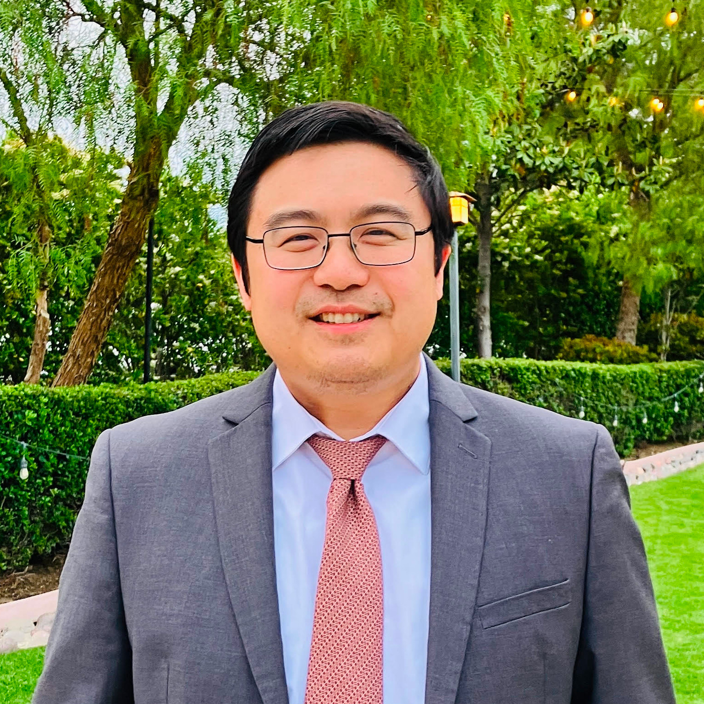
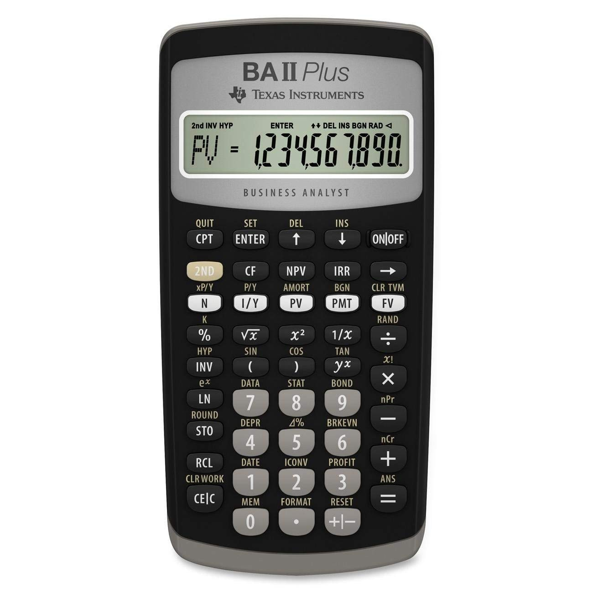
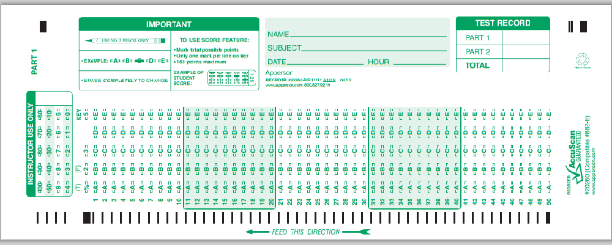

# ECON 160: Principles of Microeconomics
{: .no_toc }

## Spring 2027 Syllabus
{: .no_toc }

## Table of Contents
{: .no_toc }

- TOC
{:toc}

---

## Quick Syllabus

### Professor

- Dr. Edward Kung
- edward.kung@csun.edu

### Lectures

- Section XX: MW XX:XXam - XX:XXpm @ Bookstein XXXX

### Office Hours

- XX XX:XXam - XX:XXam @ Bookstein 4252

### Course Organization

This course meets for two lectures a week, in person.

### Grading

- **Attendance (10%)**
    
	Everyone starts with full credit. Attendance will be checked randomly or if the classroom looks half empty. Those not present when attendance is checked will lose 1 attendance point (out of 10 total).

- **In-Class Quizzes (20%)**

    I will occassionally give a short (5-10 minutes) in-class quiz. The quizzes are administered on Canvas so bring a device capable of internet access. 
    
- **Midterm Exams (40%)**

    There will be two midterm exams, each worth 20% of your grade. These will be multiple choice, in-person exams.
	
- **Final Exam (30%)**

    The final exam will be worth 30% of your grade. It will be a multiple choice, in-person exam. If you score better on your final exam than you do on the in-class quizzes, your quiz score will be replaced by your final exam score.
	
- **Participation Extra Credit (5%)**

    You can earn extra credit (up to 5 points) for contributing interesting or insightful questions or comments during class. Maximum of 1 point per lecture.

- **Grading Scale**

    |  A     |  A-   |  B+   |  B    |  B-   |  C+   |  C    |  D    |  F   |
    | ------ | ----- | ----- | ----- | ----- | ----- | ----- | ----- | ---- |
    | 100-93 | 92-90 | 89-87 | 86-83 | 82-80 | 79-77 | 76-70 | 69-60 | 59-0 |

    Your scores will be rounded up to the nearest integer. Depending on the performance of the class, a curve may or may not be applied before assigning letter grades.

---

## Tentative Schedule

| Week | Dates         | Lecture 1                            | Lecture 2                                   |  
| ---: | :------------ | :----------------------------------- | :------------------------------------------ | 
|    1 | X/XX, X/XX    | XX                         | XX                                 |   
|    2 | X/XX, X/X     | XX         | XX                  |
|    3 | X/X, X/X      | XX             | XX                                |
|    4 | XX    | XX               | XX                         |
|    5 | XX   | XX | XX                            |
|    6 | XX    | XX                        | XX                          |
|    7 | XX    | XX            | XX                    |
|    8 | XX  | XX            | XX               |
|    9 | XX  | XX                 | XX                        |
|   10 | XX  | XX           | XX                            |
|   11 | XX    | XX                        | XX                          |
|   12 | XX   | XX                           | XX                 |
|   13 | XX  | XX             | XX                               |
|   14 | XX  | XX                       | XX           |
|   15 | XX   | XX                      | XX                     |
|   16 | XX    | XX             | XX                            |    

Final Exam: 

- Section XX (XX XX:XX section): TBD

---

## Course Description

### Prerequisites

Qualifying scores on ELM and EPT, or exemption, or satisfactory completion of appropriate developmental courses.

### Course Overview

Alfred Marshall once described economics as the "study of manking in the ordinary business of life." I can't think of a better description. Economics helps us understand everything from business and politics to marriage and dating. It is not just a field of study. It is a way of thinking that helps us understand the world and the people around us. I can't think of a better subject for future CEOs, politicians, and leaders. I can't think of a better subject for becoming a more informed citizen.

In this class, you will begin your journey to **thinking like an economist**. Primarily, this means being able to see how private incentives and market forces shape the way people behave and how societies are organized. The starting point will be supply and demand in competitive markets and its applications. We will then turn to more advanced topics, like public goods, externalities, and more complex market structures.

### Course Learning Outcomes

By the end of the course, you will be able to:

- **Explain** what the study of economics is and **discuss** the role of economic theory in shaping different views of markets and public policy.

- **Explain** the principle of supply and demand and explain why economists generally believe that free markets are an efficient way to allocate resources.

- **Explain** the circumstances under which free markets fail to allocate resources efficiently and **discuss** the role of government under these circumstances.

- **Analyze** the economic principles and forces that shape a variety of real-world scenarios and market structures.

- **Predict** and **calculate** equilibrium outcomes in a variety of real-world scenarios and market structures using the appropriate economic concepts and models.

---

## Course Materials

**Textbook (Optional)**

The required textbook is *Principles of Microeconomics* by Edward Kung (ISBN: 9781644967027). It is a digital textbook that can be purchased from [Great River Learning](https://www.grlcontent.com). Click on "purchase" and enter your institution (California State University, Northridge) and select "Principles of Microeconomics". Make sure you select the correct section! You should be enrolled in one of the X following sections:

- Spring 2027: Kung: Econ 160-XX

You can also purchase access cards from the CSUN Bookstore, but I think it's cheaper to buy directly from the website.

**Calculator (Required)**

You will need a calculator for this course. Any calculator is fine.

**Video Lecture Series**

A series of video lectuers I recorded during COVID is available free of charge. These are optional but may be a helpful supplement to the textbook chapters. They cover the same material as the textbook.

**Scantrons (Form 882, Required)**

You will need these for exams. You can use off brand, but they need to be compatible with Scantron Form 882.

**Course Website**

In addition to the syllabus, this course website contains a random problem generator for you to practice solving problems that you will be assessed on in this class.

---

## Exam Policies and Information

Exams will be given in person, on paper. For exams, you should bring:

- A no. 2 pencil and eraser
- A Scantron Form 882 or compatible
- A calculator of any kind
- One sheet of paper of notes, front and back allowed (maximum size: 8"x11")
- Your CSUN ID or other photo ID showing name and picture

Other materials, including electronic devices of any kind are not allowed during exams. Violation of this policy will result in an immediate 0 on the exam.

---

## Additional Course Policies and Resources

**Communications Policy**

My preferred form of communication is in-person after class or at office hours, or by email. If you email me and I do not respond within 24 hours, do not hesitate to re-send the email. Sometimes emails get lost in the shuffle.

**Late and Missing Assignment Policy**

Requests for absences, extensions, or late submissions must be submitted by email with accompanying documentation. Only unanticipated family and medical emergencies, or other extraordinary events, will be considered valid reasons. Events that could have reasonably been anticipated, such as heavy academic workload, busy work schedule, or friends' birthday parties, will not be accepted as valid reasons.

No makeups will be given for the midterms. If you have a valid reason for missing a midterm, you will be excused from the midterm. The weight of the midterm for your final grade will be allocated to the final exam.

**AI Policy**

You are allowed to use AI for any at-home assignments to help refine your writing and your thinking. However, you are not allowed to directly submit AI generated content, either in part or in whole, and **you must be able to understand and explain any material that you submit**.

If I suspect your submission of being generated by AI, you may be asked to explain your submission via oral examination. If you cannot demonstrate a level of understanding consistent with the submitted work, you will receive a penalty on the assignment (including potentially a zero) and you may be referred to Student Affairs under the academic integrity policy.

**Academic Integrity**

By taking this course, you certify that all work is your own and that you have abided by all the rules of each assignment.

Plagiarism is not allowed, and you are not allowed to have someone else do any course work in your place unless explicitly allowed by the syllabus. 

If it is discovered that you have violated academic integrity on any assignment, you may receive a grade of zero for that assignment. Repeated violations of academic integrity may result in a failing grade for the entire course or a referral to Student Affairs.

**Special Needs**

If you have a disability or need special accommodations, please register with the Disability Resources and Educational Services ([DRES](https://www.csun.edu/dres)) office or the National Center of Deafness ([NCOD](https://www.csun.edu/ncod)). If you would like to discuss your need for accommodations with me, please contact me to set up an appointment.

Special consideration may be given to students with caregiving responsibilities at home (children, disabled family members, etc.). Please get in touch with me if you need an extension and have caregiving responsibilities.

**Emergency Food and Shelter**

If you are experiencing an emergency need for food or shelter, do not hesitate to utilize the resources available to you on campus. More information: https://www.csun.edu/heart.

**University Counseling Services**

If you have need for counseling regarding any personal or academic issues, do not hesitate to reach out to the University's counseling services. More information: https://www.csun.edu/counseling/students.

**Tutoring Services**

Tutoring services may be available for this course. Please contact the Economics Department for information: https://www.csun.edu/economics.

**Diversity Statement**

It is my intent that students from diverse backgrounds and perspectives will be well served by this course, that students' learning needs will be addressed both in and out of the classroom, and that the diversity students bring to the class will be viewed as a resource, strength, and benefit. It is my intent to present materials and activities in a way that is respectful to students from all backgrounds, and that students from all backgrounds have an equal opportunity to succeed in the course. If you have any concerns, feel free to reach out to me.

**All Other Policies**

In general, the course follows all relevant CSUN policies and procedures as documented here: https://catalog.csun.edu/policies/alphabetical. Please pay special attention to the rules on **attendance** and **academic dishonesty**.

